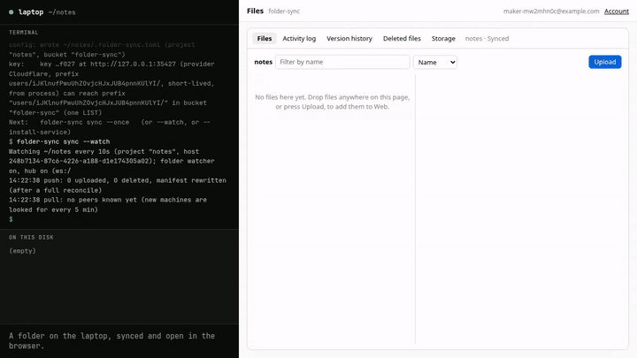
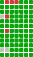
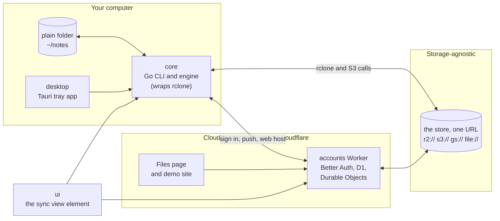

# folder-sync

Point it at any folder: that folder is now on every machine you use, and readable in a browser. Your files stay plain files on your own disk, so any editor, script or AI agent works on them with no API. folder-sync is a small command-line program that wraps [rclone](https://rclone.org); one cloud bucket keeps the always-on copy, and a web page shows the same files online, with version history to undo a mistake. It is the sync layer Zach Yamaoka's apps (Vibe Tracks, Robot Parts) share, so an app gets "Obsidian Sync for my app's folder" by dropping one element into a page.

[](docs/media/demo.mp4)

*30 seconds, recorded from the real local stack, not mocked: the real command line on the left, the real Files page on the right ([`demo.mp4`](docs/media/demo.mp4), [`demo.webm`](docs/media/demo.webm); made by [`ui/scripts/record-demo.mjs`](ui/scripts/record-demo.mjs)). The richer page is [zacharyyamaoka.github.io/folder-sync](https://zacharyyamaoka.github.io/folder-sync/).*

## Philosophy

- **File-first.** The folder on your disk is the truth. The web is a view of it, never the home of it. Zach: "100% we want local files.. that is what makes it play nice with llm." Nothing has to go through an app, and if folder-sync disappeared you would still have every file.
- **Obsidian Sync ergonomics.** Make a folder and it is the same everywhere, fast, with history, without thinking about it. His one wish on top of Obsidian Sync: "I wish I could see Obsidian Online", so the web view is part of the design.
- **Off-the-shelf parts, one missing piece.** rclone moves the bytes, Better Auth does sign-in, R2 (or any S3-style store) holds the copy, Cloudflare Workers and Durable Objects run the small server. The code here is the glue those parts do not already provide.
- **One thing, done well (the Unix way).** It does not understand what is inside your files; apps like Vibe Tracks do that. "The folder is the database."
- **Drop-in.** An app should get sync, accounts and the sync view in 20 lines of code or fewer, with no server of its own ([docs/NEW-APP.md](docs/NEW-APP.md)).
- **Honest numbers.** Every number below is generated from measurements, taken in a test rig and in production, and a gate never passes without its proof.

## Goals

Three objectives are the numbers we keep chasing (Zach, Nov 4, 2026); everything else is a gate, a yes-or-no check that must stay green.

1. **Fast.** A save reaches the other disk and the web in at most 1 second (median) and 3 seconds (95th percentile), for add, edit, delete and rename, machine to machine and machine to web.
2. **Storage efficient.** Old versions cost no more than the live files: history bytes divided by live bytes, worst of 30 days, at most 1.0 (stretch 0.25).
3. **Cheap per GB.** At most $0.50 per person-month at 10 GB, and an idle machine costs about nothing (under 0.1 % CPU). The storage provider is swappable so that we can keep choosing the cheapest.

The gates: nothing lost, version history, private, cross-platform, three surfaces (command line, desktop, web), headless, storage swappable, drop-in, ignore rules, accounts, easy to start, trusted restore. The tests behind each are in [docs/GATES.md](docs/GATES.md); how each objective is measured is in [docs/KPI.md](docs/KPI.md).

## Objectives & Gates

<!-- status:begin -->
_Generated by `scripts/readme-status` from the hourly measurements and the last gate run; do not edit between the markers. Latest measurements: test 2026-11-05 01:19 UTC, production 2026-11-05 01:19 UTC. Gates last run 2026-11-04 23:44 UTC on `0c9c02b`._

**Objectives**: numbers we keep improving, measured in a test rig and in production.

| Objective | What is measured | Target | Test | Production |
|---|---|---|---|---|
| **O1 Fast** | Save to the bytes on the other disk and online, median (p50) | ≤ 1 s | 584 ms, met | 3.2 s, missed |
|  | The same, 95th percentile (p95) | ≤ 3 s | 739 ms, met | 4.5 s, missed |
| **O2 Storage efficient** | History bytes ÷ live bytes (H), worst of the last 30 days | ≤ 1.0 (stretch ≤ 0.25) | 1.51, missed | 68, missed |
|  | H, latest sample | none (the 30-day worst is the target) | 0.46 | 0.06 |
| **O3 Cost per GB** | Cost per GB-month on the provider that holds the folders | no number set; lower is better | $0.15 | $29.04 |
|  | Cost per person-month at 10 GB, on the provider that holds the folders | ≤ $0.50 | $1.54, missed | $4.86, missed |
|  | CPU when idle | < 0.1 % | 0.089 %, met | could not be measured |
|  | Storage requests an hour when idle | none (idle cost should be about $0) | 123 | not measured yet |

**Last 30 days** (blue is test, orange is production, dashed is the target): O1  &nbsp; O2  &nbsp; O3 

Cost, compared: folder-sync against Dropbox Plus $9.99, Google Drive free $0.00, Obsidian Sync Standard $8.00 per person-month at 10 GB (list prices as of 2026-11-04).

By size: the cheapest monthly plan of each service that holds it, beside what that much storage costs folder-sync to keep (storage only, no requests).

| Size | Google | Apple | Microsoft | Obsidian | Dropbox | folder-sync on R2 | folder-sync on B2 |
|---|---|---|---|---|---|---|---|
| 10 GB | $0.00 | $0.99 | $1.99 | $10.00 | $11.99 | **$0.15** | **$0.07** |
| 100 GB | $1.99 | $2.99 | $1.99 | – | $11.99 | **$1.50** | **$0.70** |
| 1 TB | $9.99 | – | – | – | $11.99 | **$15.00** | **$6.95** |
| 2 TB | $9.99 | – | – | – | $11.99 | **$30.00** | **$13.90** |

**Gates**: pass or fail, checked on every change. 12 of 12 gates pass.

**Gate history** (the last 7 CI and local runs, oldest on the left; rows are G1 to G12; green passed, red failed, grey not built or skipped): 

| Gate | What it checks | Status |
|---|---|---|
| **G1** Nothing lost | Random edits, deletes, renames and crashes end with every file and every kept version intact. | pass (77 passed) |
| **G2** Version history | Any version from the last 30 days restores byte for byte; deleted files restore for 30 days. | pass (33 passed) |
| **G3** Private | No account can read another account's files. | pass (8 passed) |
| **G4** Cross-platform | Linux, macOS and Windows all pass CI, and the desktop installers install on all three. | pass (10 passed) |
| **G5** Three surfaces | The command line, the desktop app and the web page each pass one full journey. | pass (3 passed) |
| **G6** Headless | A fresh machine syncs from a script with no prompt and no browser. | pass (1 passed) |
| **G7** Storage provider swappable | The same journey passes on R2, another S3-compatible store and a plain folder. | pass (26 passed) |
| **G8** Drop-in | An app adds sync, accounts and the sync view in 20 lines of code or fewer. | pass (3 passed) |
| **G9** Ignore rules | gitignore-style rules; OS junk ignored by default; accented names land exactly once. | pass (9 passed) |
| **G10** Accounts | Google and email-code sign-in; one deployment per app. | pass (69 passed) |
| **G11** Easy to start | From a fresh machine to the first sync in 2 minutes or less. | pass (6 passed) |
| **G12** Trusted restore | A restore takes 5 seconds or less. | pass (1 passed) |
<!-- status:end -->

The same numbers with a chart per series and the tests behind each gate: `scripts/dev-view` ([docs/DEV-VIEW.md](docs/DEV-VIEW.md)). This block is rewritten by `scripts/readme-status` from the hourly measurements and the last gate run (its tests: `node --test tests/readme-status/readme-status.test.mjs`).

## The parts

One repo, four named parts, with seams that tests enforce ([PARTS.md](PARTS.md) is the map). The **core** works alone on a bucket key, with no server at all; the Cloudflare parts can change without touching it.



| Part | What it is | Cloudflare-specific? |
|---|---|---|
| **core** (`cmd/`, `internal/`, `e2e/`, `schema/`) | The Go command line and engine: init, sync, history, restore, `serve`. Works alone on a bucket key. | No. Only `internal/account`, `internal/viewer`, `internal/push` and the `r2://` kind talk to Cloudflare. |
| **server-cloudflare** (`accounts/`, `demo/`) | The accounts Worker (Better Auth, D1, Durable Objects: key broker, web host, push hub, history, quota) and the demo site. | Yes, entirely. |
| **ui** (`ui/`, `app/ui/`) | `<folder-sync-status>`, the one sync view an app drops in, and the desktop app's page. | No: it speaks the same HTTP API to the Worker or to `folder-sync serve`. |
| **desktop** (`app/src-tauri/`) | The Tauri shell and installers; wraps the core as a sidecar. | No. |

They meet at three seams only: the bucket layout and manifest ([docs/CONTRACT.md](docs/CONTRACT.md)), the credential process ([PEP 0002](docs/peps/0002-short-lived-scoped-credentials.md)) and the `/fs/v1` HTTP API ([docs/API.md](docs/API.md)). `scripts/check-core-alone` runs the core with the server part deleted.

## Quick start

1. **Install.** The pinned rclone is fetched and checked (SHA-256) on the first `init`; everything folder-sync keeps lives in `~/.folder-sync/`.

   ```bash
   go build -o ~/.folder-sync/bin/folder-sync ./cmd/folder-sync
   ```

   Binaries for Linux and macOS are on the [Releases page](https://github.com/zacharyyamaoka/folder-sync/releases) (v0.2.0, a pre-release that predates shared folders and swappable storage), with the desktop installers. Put `~/.folder-sync/bin` on your PATH. For Windows: `GOOS=windows GOARCH=amd64 go build -o folder-sync.exe ./cmd/folder-sync`.

2. **Sign in.** It prints a link and a code; you approve the code in your browser. Hosted accounts are invite-only for now. With your own bucket instead, use a key (`folder-sync login --key`; see [Storage providers](#storage-providers)).

   ```bash
   folder-sync login
   ```

3. **Add a folder.** In any folder:

   ```bash
   folder-sync init --project notes
   folder-sync sync --watch
   ```

   Do the same on your other computers, then open the Files page (`/fs/files` on the accounts server) to see the folder online. `folder-sync sync --install-service` keeps it running in the background, `folder-sync status` shows the last rounds, and `folder-sync history FILE` and `folder-sync restore FILE` undo a change.

To try everything on one machine with no cloud account, [run the local stack](#try-it-with-no-cloud-account): the demo above is exactly that.

## Drop it into an app

An app that keeps its data in a folder gets sync, accounts and the sync view from one Worker mount and one element:

```html
<folder-sync-status project="notes"></folder-sync-status>
```

[docs/NEW-APP.md](docs/NEW-APP.md) is the step by step (one Worker, one D1 database and one bucket prefix per app, four feature switches); [docs/API.md](docs/API.md) is the element and its HTTP API; [docs/PAYMENTS.md](docs/PAYMENTS.md) covers plans and bring-your-own-bucket. Vibe Tracks ([vibetracks.dev](https://vibetracks.dev)) and Robot Parts ([robotparts.dev](https://robotparts.dev)) use it today.

## Storage providers

A folder's bytes live behind one URL in `.folder-sync.toml`; changing provider is changing that line ([docs/STORAGE.md](docs/STORAGE.md) has the keys and the capability table):

```toml
store = "r2://folder-sync"                             # Cloudflare R2 (the default)
store = "s3://my-bucket/folder-sync?region=eu-west-1"  # AWS S3, or any S3-compatible store: Backblaze B2, Wasabi, MinIO
store = "gs://my-bucket/folder-sync"                   # Google Cloud Storage (HMAC key)
store = "file:///mnt/nas/folder-sync"                  # a plain directory; nothing leaves the machine
```

The accounts Worker, the web host and the quota exist for `r2://` only; the other stores are the core on its own. The same journey (add, edit, rename, delete, restore) runs against R2, MinIO and a directory in the tests (gate G7), and provider prices feed the cost objective ([docs/PRICES.md](docs/PRICES.md)).

## Docs

| | |
|---|---|
| [PARTS.md](PARTS.md) | the four parts, the three seams, what may import what |
| [docs/CONTRACT.md](docs/CONTRACT.md) | the bucket layout, the manifest, history and the shared tree: what apps read |
| [docs/API.md](docs/API.md) | the sync view's HTTP API and `<folder-sync-status>` |
| [docs/NEW-APP.md](docs/NEW-APP.md), [docs/STORAGE.md](docs/STORAGE.md) | give an app its own accounts; pick where the bytes live |
| [docs/GATES.md](docs/GATES.md), [docs/KPI.md](docs/KPI.md) | the twelve gates and the three objectives, and how each is measured |
| [docs/DEV-VIEW.md](docs/DEV-VIEW.md) | the dev view: objectives and gates at a glance, drill down |
| [docs/PLATFORMS.md](docs/PLATFORMS.md) | testing macOS and Windows without owning either (GitHub runners) |
| [docs/peps/](docs/peps/) | the design decisions, one numbered proposal each (0001 wrap rclone and R2 ... 0010 the shared tree) |

## Reference

### Short-lived credentials

Instead of a stored key, `FOLDER_SYNC_CREDENTIAL_PROCESS` can name a program (a JSON array, its argv, `argv[0]` absolute) that prints short-lived keys scoped to one account prefix: AWS's `credential_process` JSON (`Version` 1, `AccessKeyId`, `SecretAccessKey`, `SessionToken`, `Expiration`) plus optional `Endpoint`, `Bucket` (the only bucket these keys can use), `Prefix` (the account root, like `users/AbC123/`), `Region` and `Provider`. folder-sync runs it before every round, caches the answer in `~/.folder-sync/session.json`, and syncs under that prefix ([`docs/CONTRACT.md`](docs/CONTRACT.md), "Bucket layout"). Exit 3 means signed out (`sync --once` then exits 4); any other failure is transient and still-valid cached keys carry on. `sync --once` exits 75 when another round holds the folder. An app that signs a person's next machine in asks `folder-sync projects --json` which folders that person already syncs, and `sync --discover` looks for new machines at once instead of within 5 minutes ([`docs/peps/0002`](docs/peps/0002-short-lived-scoped-credentials.md)).

### Accounts: sign in instead of pasting a key

folder-sync has its own accounts ([`docs/peps/0003`](docs/peps/0003-accounts.md)): one sign-in across every app that syncs a folder (robotparts.dev first), served by the `accounts/` Worker (Better Auth on Cloudflare Workers + D1), mounted at `/fs/` on each app's own domain.

```text
folder-sync login [--server URL]     sign this machine in: open the printed link, approve the code in your browser
folder-sync whoami                   who this machine is signed in as, and its account root (users/<id>/)
folder-sync credentials              the credential-process JSON (short-lived keys for users/<id>/); exit 3 signed out
folder-sync publish --public         anyone can read this folder online; --private undoes it
folder-sync logout                   end this machine's session on the server, then delete account.json
folder-sync login --key              v0's stored bucket key instead (credentials.json)
```

The server is `--server`, else `FOLDER_SYNC_SERVER`, else the accounts Worker's own host; an app prints its own (`folder-sync login --server https://robotparts.dev`) so the approving browser is usually signed in already. The session is kept in `~/.folder-sync/account.json` (`folder-sync-account/1`, mode 0600). Once it exists, and neither `FOLDER_SYNC_CREDENTIAL_PROCESS` nor a key is set in the environment, folder-sync runs its own `credentials` as the credential process, so the short-lived keys, their cache and their exit codes are PEP 0002's, unchanged; a key in the environment still wins, and a signed-in machine no longer uses a stored `credentials.json`.

### A shared folder: every machine and the web edit the same files

```text
folder-sync share [--private PATTERN]...   one tree for the folder: every machine, agent and page edits it (needs login)
```

By default each machine publishes its own files and receives the others' read-only. `share` makes the folder one tree ([`docs/peps/0010`](docs/peps/0010-shared-tree.md)): the files are the folder itself on every machine, the folder's object on the accounts Worker puts every change in order, two edits to different lines of a note merge, and a collision becomes `name (Conflicted copy <machine> <YYYYMMDDHHMM>).ext` beside it (Obsidian's name), never markers inside a file. Patterns named with `--private` (gitignore syntax) stay on each machine's own host; nothing is private unless named. Every other machine joins at its next sync. Sharing cannot be undone or re-ruled in this version, and it needs the accounts server.

Run the Worker locally (rclone serve s3, the R2 stand-in, `wrangler dev` with a local D1 and generated test keys): `npm install --prefix accounts`, then `node accounts/scripts/dev.mjs up` (`down` stops exactly what it started). Its tests: `node --test accounts/test/worker.test.ts` and the end-to-end proof `node accounts/test/proof.mjs` (ports 4930-4932).

### Desktop app

The same engine in a tray app ([`app/`](app/README.md), [PEP 0006](docs/peps/0006-desktop-app.md)): sign in, choose a folder, and it stays in sync. Installers for macOS (`.dmg`), Windows (`.exe`, `.msi`) and Linux (`.deb`, `.AppImage`) are built by the `desktop-release` workflow from a `desktop-v*` tag and published as a pre-release on the [Releases page](https://github.com/zacharyyamaoka/folder-sync/releases); they are not signed yet, so the first open needs the steps in [`app/release/NOTES.md`](app/release/NOTES.md).

Choosing a folder works like Obsidian's vault picker: **Create new folder** (a name and a place, `~/folder-sync/<name>` by default), **Open existing folder** (its files upload) or **Your folders online** (on a second computer, download one a first computer set up). Every folder the app makes is a shared tree, so the same files are on each computer and on the Files page (**Open online**). The server is `https://vibetracks.dev`; another one goes under *Advanced* in the first-run window. `app/test/journey.mjs` runs that whole story on two computers (Linux and a real Mac in CI); `app/scripts/real_window.mjs` drives the real binary on a virtual display.

### Try it with no cloud account

These assume the checkout is at `~/folder-sync`; Go is on your `PATH`, or at `~/.local/go/bin`.

```bash
"$HOME/folder-sync/scripts/dev-tools"
PATH="$HOME/.local/go/bin:$PATH" go -C "$HOME/folder-sync" test ./...
```

`scripts/dev-tools` fetches the pinned rclone for Linux (amd64, arm64), macOS (Intel, Apple silicon) or Windows (amd64, arm64; run it from Git Bash, it writes `.tools/rclone.exe`) into `.tools/`, checked against the same SHA-256 table `init` uses (`internal/rclonebin/install.go`).

The end-to-end test (`e2e/`) runs two simulated machines (two HOME dirs, two folders) against `rclone serve s3` on 127.0.0.1:4801 with throwaway keys, through a counting proxy on :4802. It needs:

- `.tools/rclone` from `scripts/dev-tools`, or the whole suite skips. CI sets `FOLDER_SYNC_E2E_REQUIRE=1`, which turns every such skip (rclone, node, python's `jsonschema`, git) into a failure.
- `python3` with the `jsonschema` module (`python3 -m pip install jsonschema`) for the manifest-schema check. macOS's stock `python3` (3.9) does not ship it; without it that one subtest skips and says so.
- `node` ≥ 22.18 for the Worker-reader check, which skips without it.
- Ports 4801 and 4802 free.

On a case-insensitive folder (the macOS default) `README.md` and `readme.md` are one file, so the case-twin checks are skipped there and the single file is expected to upload.

### The real-R2 check (Zach)

1. In the Cloudflare dashboard → R2 → Create bucket `folder-sync` (location: automatic). Leave public access off: no r2.dev URL, no custom domain.
2. R2 → Manage API tokens → Create API token: permission "Object Read & Write", applied to the `folder-sync` bucket only. Copy the access key id and secret (shown once) and the account id.
3. Run:

   ```bash
   export FOLDER_SYNC_ACCOUNT_ID=<account id> FOLDER_SYNC_ACCESS_KEY_ID=<key id> FOLDER_SYNC_SECRET_ACCESS_KEY=<secret> FOLDER_SYNC_CHECK_BUCKET=folder-sync
   "$HOME/folder-sync/scripts/check-r2"
   ```

   It writes and then deletes two objects under `_checks/<stamp>/`. All five lines should say PASS.
4. While there: R2 → the bucket → Settings → Object lifecycle rules → delete objects with prefix `_trash/` after 30 days (no bucket lock: PEP 0003 §3.7); and a budget alert at a few dollars a month.

## What is real and what is pending

The status block above is the live answer for objectives and gates. Beyond it:

- **Deployed:** the accounts Worker is live at `https://vibetracks.dev/fs`, with the Files page, history, push, the shared tree and the account page. Hosted sign-up is invite-only.
- **Not yet proved on macOS and Windows:** G4 and G11 stay "not built yet" until the GitHub macOS and Windows runs report ([docs/PLATFORMS.md](docs/PLATFORMS.md)); the binaries cross-compile and the unit tests run on all three.
- **`shared` in `[modes]`** is refused on purpose: use `folder-sync share` (PEP 0010).
- **Pending Zach:** a lifecycle rule on legacy `_trash/` and a budget alert in the R2 dashboard; the manual real-R2 check above.

## What it does not do (in the spirit of Unix)

- It does not understand what's in the files. Apps like Vibe Tracks do that.
- It does not reinvent a sync engine where a stock one is good enough. It wraps the engine and owns only the missing piece: one simple command line, a Windows-safe install, per-project config, and the online read view.

## Status

Started 2026-10-20 as a separate project, split out of Vibe Tracks (Zach: "clearly a separate functionality that I can get right once and then reuse"). PEP 0001 was accepted the same day, with BearDrive as the reference product; the PEPs after it record each design decision.

The name is literal on purpose, like `stable_preview_switcher`: a plain repo name, not a brand. An unrelated Android app is also called FolderSync (foldersync.io).

MIT licensed ([LICENSE](LICENSE)).
